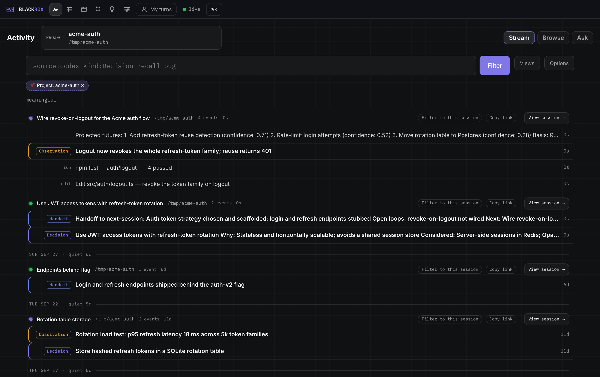
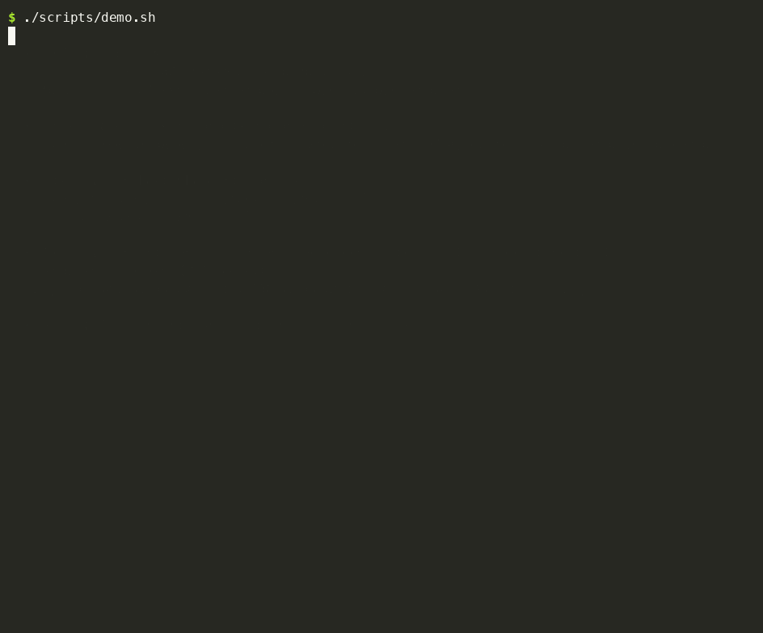
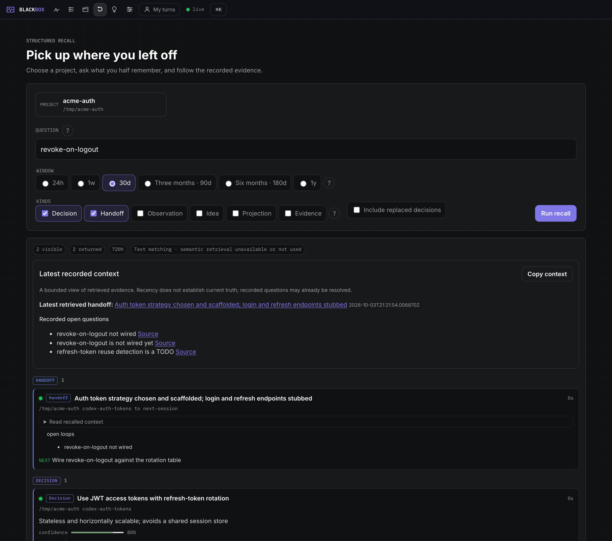
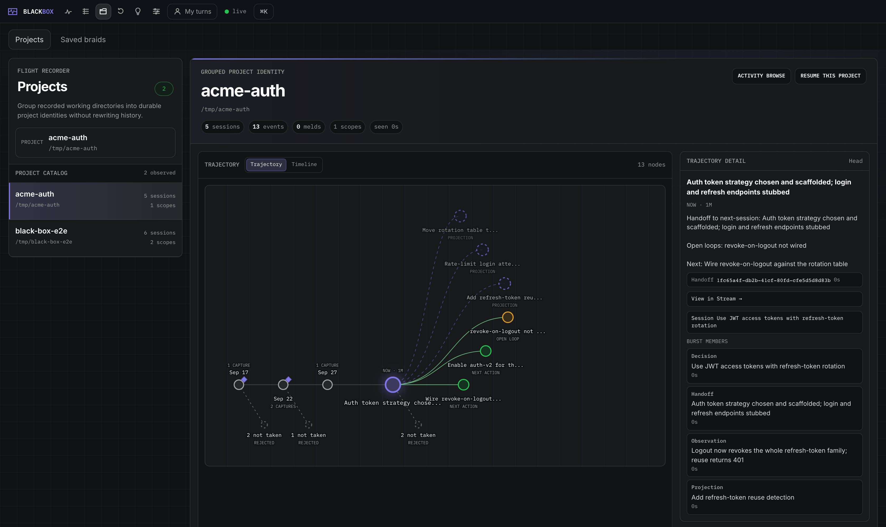

<div align="center">
  
  <h1>Black Box</h1>
  <p><strong>Shared memory for coding agents.</strong></p>
  <p>Keep the decision, the reason, and the next step.<br>Recall them when another session picks up the work.</p>
  <p>
    <a href="docs/installation.md">Get started</a> ·
    <a href="docs/agent-integration.md">Connect an agent</a> ·
    <a href="docs/README.md">Documentation</a>
  </p>
  <p>
    <a href="https://openjdk.org/projects/jdk/21/"></a>
    <a href="docs/agent-integration.md"></a>
    <a href="LICENSE"></a>
  </p>
</div>

Work can outlast an agent session. Black Box gives Codex, Claude Code, and other MCP clients a
place to record decisions and handoffs, then retrieve that context before continuing. You can
inspect the same records in a local web app, follow them back to their sources, and see how a
project's direction changed.

It runs locally with SQLite by default. Models and external search services are optional for the
core capture-and-recall loop.



## Try the loop

1. **Capture a decision:** what changed, why, and which alternatives were rejected.
2. **Leave a handoff:** the verified state, unfinished work, and one useful next action.
3. **Recall the context:** a later session asks `recallContext` for the project or topic and receives
   a bounded set of records with their sources.



The demo uses synthetic records and the actual API. [Read or reproduce the demonstration](docs/showcase.md).

### Run a disposable demo

On **macOS or Linux**, install Java 21+, Maven 3.9+, Bash, `curl`, `jq`, and `lsof`, then:

```bash
git clone https://github.com/nathanmauro/black-box.git
cd black-box
./scripts/quickstart.sh
```

The script builds the app, starts a private scratch database, runs the capture-and-recall example,
and serves the UI at [localhost:8766](http://localhost:8766), opening it automatically on macOS.
Model calls, external summaries, and editor
launching are disabled for the demo. An occupied port is refused; choose another with
`SBA_DEMO_PORT=8877 ./scripts/quickstart.sh`. The script prints how to stop its process and remove
its scratch directory when you are done.

For a persistent installation, downloads, Windows guidance, and service setup, follow the
[installation guide](docs/installation.md).

**Source vs. tagged release:** this README describes `main`. The earlier
[v0.2.0](https://github.com/nathanmauro/black-box/releases/tag/v0.2.0) JAR predates the October
decision-ledger narrowing and still includes the retired task board; see its
[release boundaries](docs/releases/v0.2.0.md) and [board retirement notes](docs/board-retirement.md)
before upgrading an existing installation.

## Connect your agents

A running Black Box server exposes Streamable HTTP MCP at `http://localhost:8766/mcp`:

```bash
codex mcp add sba-agentic --url http://localhost:8766/mcp
claude mcp add --transport http --scope user sba-agentic http://localhost:8766/mcp
```

Use your chosen port if it differs. Once registered against a running server, agents can call
`recallContext` at the start of a task and `captureDecision` or `captureHandoff` at closeout. Opt-in
hooks can also record session events (including Claude `Stop` responses) or inject a compact startup
recall packet; see [Agent integration](docs/agent-integration.md) and the restricted
[ChatGPT gateway](docs/chatgpt-mcp.md).

## Find the context behind the work

**Recall** separates the project from the question. Read decisions and handoffs, copy a briefing,
follow supporting evidence, and explicitly record when a decision has been replaced.



**Activity and Browse** let you search recorded events, filter by source or kind, inspect sessions,
and follow parent/child agent relationships. Saved views and projectless braids help collect
related work without moving the underlying records.

**Trajectories** put recorded history beside proposed next steps. Selecting a node reveals its
source. Projections are possibilities written by an agent; their declared confidence is not a
calibrated prediction.



The optional [macOS companion](docs/companion.md) provides a small activity view and opens
project-scoped recall. The browser interface remains available without the native companion.

## What to expect

| Area                | Current behavior                                                                                                                                                                                                                                                                                                                                                                          |
| ------------------- | ----------------------------------------------------------------------------------------------------------------------------------------------------------------------------------------------------------------------------------------------------------------------------------------------------------------------------------------------------------------------------------------- |
| Storage             | SQLite by default. Optional PostgreSQL owns a separate database for a single API server; local and PostgreSQL histories do not auto-synchronize.                                                                                                                                                                                                                                          |
| Recall              | Lexical retrieval works without a model. Optional semantic recall indexes structured intent (`Decision`, `Handoff`, `Observation`, `Idea`, `Evidence`) and falls back to lexical search when embeddings are unavailable; projections are lexical-only, session-summary vectors are stored for backfill rather than returned by recall today, and the raw event log is searched lexically. |
| Summaries           | A session that closes with a standing handoff reuses that handoff directly as its summary (`summary_source = handoff`) with no model call; sessions that moved past their last handoff fall back to the configured summary backend.                                                                                                                                                       |
| Capture & streaming | Explicit MCP/REST tools plus opt-in hooks, idempotent capture keys, an optional local retry outbox, and cursor-based SSE replay for `event.appended` notifications.                                                                                                                                                                                                                       |
| Scope               | Self-hosted memory and lineage server; it records and retrieves context rather than executing coding agents, and no hosted service is offered here.                                                                                                                                                                                                                                       |

**Data and access:** the default server listens on `127.0.0.1:8766` without authentication. Network
exposure requires [authentication and HTTPS](docs/authentication.md). When model summarization runs,
the default source configuration invokes an external Codex wrapper that sends transcript text to
that provider; choose a model-disabled or `SBA_SUMMARY_BACKEND=local` setup in the
[installation guide](docs/installation.md) to keep summarization local. Ingestion redaction is
best-effort; see [configuration and redaction limits](docs/operations.md#configuration).

## Architecture and measured behavior

Black Box is structured as a feature-first modular monolith (`recording`, `memory`, `lineage`,
`project`, `summary`, `judgment`, `ask`, `query`, `platform`) on Java 21, Spring Boot, and Spring
Modulith, with SolidJS/TypeScript compiled into the JAR:

- **Enforced module boundaries:** cross-module and hexagonal dependency rules are checked in tests
  by Spring Modulith and ArchUnit (`ApplicationModuleStructureTest`, `PackageArchitectureTest`).
  Canonical relational writes commit before optional Elasticsearch, SSE, or summary fan-out.
- **Measured hot-path optimizations:** reproducible query-plan, work-count, service-merge, and
  Playwright byte-budget checks cover
  [indexed transcript deduplication](docs/performance/transcript-deduplication.md),
  [batched lineage header projections](docs/performance/lineage-metadata.md),
  [covering-index dashboard range bounds](docs/performance/dashboard-activity-range.md),
  [lazy SSE stream payloads](docs/performance/stream-payload-work.md),
  [on-demand frontend route chunks](docs/performance/frontend-route-loading.md), and
  [palette/story request budgets](docs/performance/frontend-request-budgets.md).
- **Dogfooding and bounded evaluations:** Black Box is used daily while developing Black Box. Read
  the [traceable development case study](docs/building-black-box.md),
  [project evolution and retired designs](docs/evolution.md), and the
  [resumption evaluation](docs/real-resumption-evaluation.md) (which separates measured checkpoint
  reconstruction from broader, unproven productivity claims).

## Develop and contribute

The backend uses Java 21, Spring Boot, and Spring Modulith. The frontend uses SolidJS and TypeScript;
its built assets are included in the JAR. Node is needed for frontend development, not for running a
downloaded release.

Run commands from the repository root:

```bash
mvn test
(cd frontend && npm ci && npm test)
(cd frontend && npm run check)
(cd frontend && npm run build)
./scripts/verify.sh --e2e
```

Use a separate checkout for verification builds if a service is running from your working copy;
packaging replaces files under `target/`. The full verification path includes packaged browser
journeys against disposable storage. See
[frontend standards](docs/frontend-standards.md), [Java formatting](docs/java-formatting.md),
[Java test stories](docs/java-tests.md), [architecture](docs/architecture.md), and
[package conventions](docs/architecture/package-conventions.md).
The [documentation index](docs/README.md) separates user guides, contributor references, experiments,
and historical design records.

## License

[MIT](LICENSE) © 2026 Nathan Mauro
